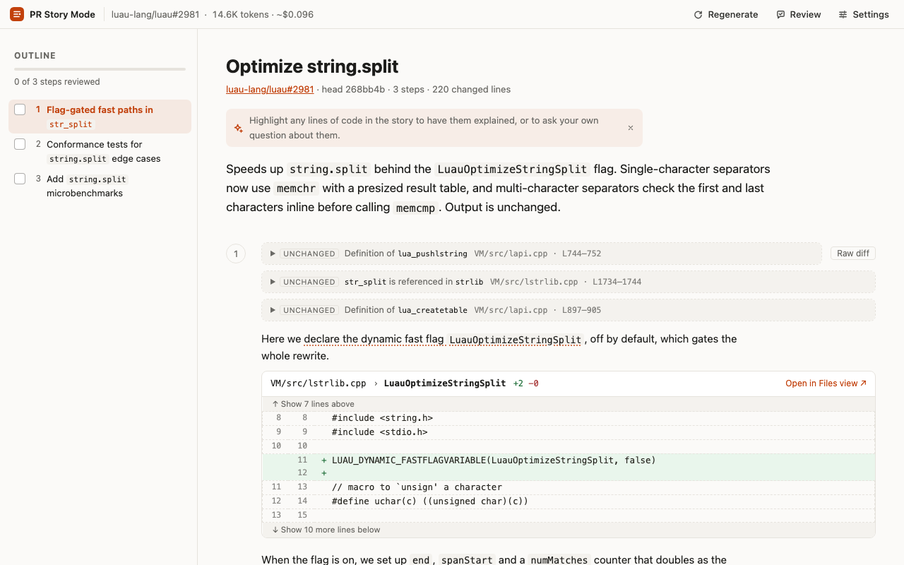

# PR Story Mode

Read a GitHub pull request as a story instead of a pile of files.

PR Story Mode puts a pull request's changes in an order that makes sense, such as the new type before the code that uses it, or the helper before its callers. It explains each step in plain language, with the code right below the words that describe it. Every changed line appears exactly once, so you can still review it line by line and nothing gets skipped.



It comes in two forms:

- **A Chrome extension** that adds a **Story mode** button to pull requests on GitHub. This is the easiest way to use it.
- **A command-line tool** that writes a story as an HTML page. It's useful for local branches, for scripts, and at companies that route AI through their own gateway.

**Contents:** [Install the extension](#install-the-extension) · [Read a story](#read-a-story) · [Ask about code](#ask-about-code) · [Review without leaving the story](#review-without-leaving-the-story) · [Settings](#settings) · [Command-line tool](#command-line-tool) · [How it works](#how-it-works) · [Privacy](#privacy)

## Install the extension

1. Install **PR Story Mode** from the [Chrome Web Store](https://chromewebstore.google.com/detail/pr-story-mode/cpjdcnhddbojekjfbngjpkiiealhbkam). It's built for Chrome, and other browsers that install from the Chrome Web Store should work too.
2. The settings page opens. Pick a model provider and paste your API key (see [Settings](#settings)).
3. Optional: add a GitHub token. You'll need one for private repositories and for posting review comments.
4. Open any pull request on github.com and press **Story mode**.

You can also skip the model (choose **No model** in settings). Stories then show the changes in dependency order with short template descriptions, and nothing is sent anywhere except GitHub.

## Read a story

- **The outline** on the left lists the steps. Tick a step's box, or press **Mark step reviewed** at the end of it, to keep track of where you are.
- **Steps appear as they're written.** The first one usually shows within about 15 seconds, and you can start reading while the rest are written.
- **Words link to code.** Phrases in an explanation link to the lines they describe. Click one to jump to those lines and highlight them.
- **Unchanged code that helps** is shown above a step, collapsed and labelled *Unchanged*. This could be the definition a change relies on or a caller it affects.
- **Show more lines** above, below or inside any piece of code, as on GitHub. **Raw diff** shows a step's code exactly as GitHub does.
- **Bulky changes fold away**: re-indented code, long data tables, the same edit repeated many times, and deleted files each fold into a one-line summary you can open.
- **Mechanical changes** (formatting, renames, reordered imports, lockfiles and generated files) are collected after the steps in their own section, marked with a wrench. You mark it reviewed like a step.
- **Stories are saved.** Reopening a pull request is instant and free. If new commits were pushed, a banner offers to update the story. Usually only the steps whose code changed are written again.

## Ask about code

Highlight any lines of code in a story and a small bar appears:

- **Explain** walks you through those lines.
- **Ask…** lets you type your own question.

The answer appears under the code you highlighted. It can point to specific lines, and to definitions elsewhere in the repository. You can ask follow-up questions. Answers are private: they're never posted to GitHub, and they're saved in your browser with the pull request.

## Review without leaving the story

- Existing review comments show under the lines they're about.
- Click the **+** beside a line number to comment on it. Drag it, or shift-click another line, to comment on a range.
- Post a comment right away, or add it to a pending review. Then press **Review** in the top bar to submit everything as a comment, an approval or a change request.
- Comments support Markdown, with a toolbar, keyboard shortcuts and GitHub's **Suggest** blocks.

Everything goes through GitHub, so teammates without the extension see ordinary review comments. Posting needs a GitHub token with **Pull requests: Read and write** (see below).

## Settings

Open the settings from **Settings** in a story's top bar, or from the extension's menu in Chrome.

**Model.** PR Story Mode uses your own API key. Nothing goes through a server of ours.

| Provider | What you need |
|---|---|
| Anthropic | An [Anthropic API key](https://console.anthropic.com/). The default model is Claude Opus 5.5. |
| OpenAI | An [OpenAI API key](https://platform.openai.com/api-keys). The default model is GPT-5. |
| OpenAI-compatible | The base URL of a server that speaks the OpenAI chat API, such as a company gateway, vLLM, Ollama or LiteLLM, plus a model name. |
| No model | Nothing. Stories show the changes in order, without explanations. |

For a company gateway that speaks Anthropic's API, choose Anthropic, fill in the **Base URL**, and pick how the key is sent (`x-api-key` or `Authorization: Bearer`). Your gateway's setup notes will say which.

**Cost.** You pay your provider directly. With Claude Opus 5.5, most pull requests cost 5 to 30 cents (about 11 cents is typical), and a very large one of 1,500 lines or more can cost about a dollar. The top bar shows what each story cost, and reopening a saved story costs nothing.

**Explanations.** **Standard** walks through what the code does and why, skipping lines that speak for themselves. **More detail** links nearly every changed line to the words that explain it, and adds background where the code would be hard to follow without it. It's longer, so it takes a little more time and costs a bit more.

**GitHub token.** Optional, but needed for private repositories and for posting comments. Without a token, GitHub allows 60 requests an hour, which is enough for several stories. Create a [fine-grained token](https://github.com/settings/personal-access-tokens/new) with:

- **Contents: Read**, to read private repositories;
- **Pull requests: Read and write**, to post comments. Read-only is enough if you only read stories.

**GitHub Enterprise.** Add your company's GitHub host (like `github.acme.com` or `acme.ghe.com`) with a token from that host. The **Story mode** button then appears there too.

**Appearance.** Theme (system, light or dark), accent color, diff colors (including blue and orange for color-blind readers), fonts and text sizes.

## Command-line tool

The command-line tool writes the same story as a single HTML page you can open, save or share. It needs [Node.js](https://nodejs.org/) 20 or later.

```bash
git clone https://github.com/pr-story-mode/pr-story-mode.git
cd pr-story-mode
npm install
npm run build:cli
```

This builds `packages/cli/dist`. Add that folder to your `PATH`, or run `node packages/cli/dist/pr-story.mjs` instead of `pr-story` below. The folder doesn't need anything else installed, so you can copy it to another computer that has Node.

### First run

```bash
pr-story setup
```

Setup asks where code should go (the Anthropic API, a company gateway, an OpenAI-compatible server, or no model) and where to get your keys and GitHub tokens. Your setup never stores a key itself, only where to read it: an environment variable, the macOS Keychain, the GitHub CLI's login, or a command that prints a fresh token. That last option is for company tokens that expire every hour.

```bash
pr-story check https://github.com/owner/repo/pull/123
```

`check` tries your key, gateway and GitHub access, explains how to fix anything that fails, and lists exactly where code will be sent.

Without running `setup`, the tool reads the usual environment variables: `ANTHROPIC_API_KEY` (or `ANTHROPIC_AUTH_TOKEN` and `ANTHROPIC_BASE_URL` for a gateway), `OPENAI_API_KEY` and `GITHUB_TOKEN`.

### Write a story

```bash
pr-story https://github.com/owner/repo/pull/123                  # a GitHub pull request
pr-story story --repo ../my-repo --base main --head my-branch    # a local branch, before you open a PR
```

The story is saved as `stories/<name>/story.html`. Add `--open` to open it in your browser when it's ready, or say yes during `setup` to always open it.

### Options

| Option | What it does |
|---|---|
| `--provider anthropic\|openai\|openai-compatible\|none` | Choose the model provider for this run |
| `--model <id>`, `--base-url <url>` | Choose the model, or point at a gateway or self-hosted server |
| `--detail more` | Write the **More detail** version of the story |
| `--repo <dir>` | With a PR URL, read unchanged code from a local clone instead of GitHub |
| `--no-context` | Send only the changed code to the model, with no unchanged code beside it |
| `--out <dir>` | Where to save the story |
| `--open`, `--no-open` | Open the story in your browser, or don't |

Run `pr-story` with no arguments for the full list.

For a self-hosted model through Ollama:

```bash
pr-story https://github.com/owner/repo/pull/123 --provider openai-compatible --base-url http://localhost:11434/v1 --model llama3.3
```

## How it works

1. **Split the change into pieces.** Each changed line is matched to the smallest piece of code around it, such as a function, a method, a class field or a config key. A change touching two functions becomes two pieces.
2. **Find what depends on what.** If one piece defines something another uses, the definition comes first.
3. **Set aside mechanical changes.** Formatting, renames, reordered imports, lockfiles and generated files are moved to their own section, so the steps show real changes.
4. **Plan the order.** The model groups the pieces into steps and orders them so they read well. The plan is checked: every line must appear exactly once, and no step may come before what it depends on unless the model says why. A plan that fails the check goes back to the model to fix.
5. **Find helpful unchanged code**, such as definitions the changed lines use and callers of code that changed.
6. **Explain each step**, a few sentences at a time, each followed by the code it describes.

Steps 1 to 3 understand code in these languages:

| | Languages |
|---|---|
| Best support | TypeScript, JavaScript, Python, Go, Rust, Java, Ruby, C#, PHP |
| Good support | C, C++, JSON, YAML, TOML |
| Everything else | Split by the diff's own sections, still ordered and explained |

For the technical details, see [docs/DESIGN.md](docs/DESIGN.md).

## Privacy

- The extension has no servers, accounts or analytics.
- Your settings, keys, saved stories and answers stay in your browser.
- Code is sent only to the AI provider you choose, and your GitHub token only to GitHub.

The [privacy policy](PRIVACY.md) has the details.

## Contributing

Bug reports and pull requests are welcome. To work on the code:

```bash
npm install
npm test
npm run build             # the extension (packages/extension/dist) and the command-line tool
```

To try your build of the extension:

1. Open `chrome://extensions` and turn on **Developer mode**.
2. Choose **Load unpacked** and pick `packages/extension/dist`.

[docs/DESIGN.md](docs/DESIGN.md) explains how the code is organized.

## License

[MIT](LICENSE). Questions: egbenedictdev@gmail.com.
